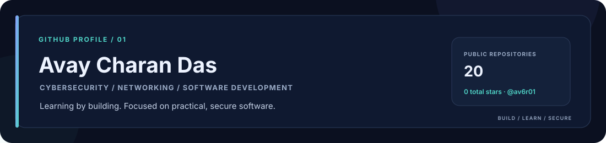
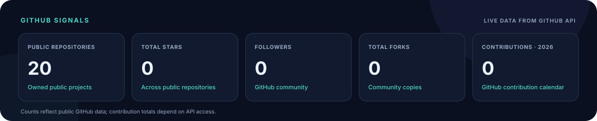
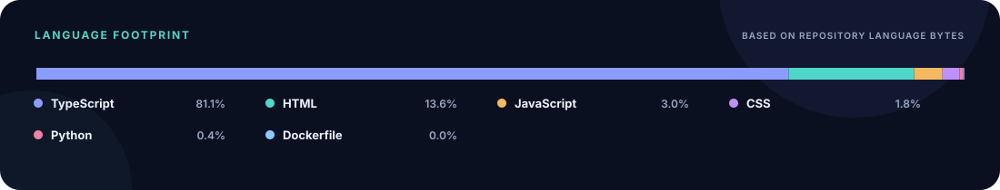

**Cybersecurity · Network Security · Python · Web Development**

---

## About

I'm **Avay Charan Das**, a student focused on cybersecurity, networking, and software development. I enjoy learning how systems work, exploring security concepts, and building practical tools.

- **Security:** learning cybersecurity concepts and defensive practices.
- **Networking:** exploring protocols, infrastructure, and system communication.
- **Python:** automation, scripting, and practical utilities.
- **Web development:** building functional applications and interfaces.
- **Go:** currently learning Go for efficient software development.

> Learn by building. Improve through experimentation. Keep the work practical.

## GitHub Statistics

## Languages

## Selected Projects

## Contribution Activity

---

**Build · Learn · Secure · Repeat**

Profile visuals are generated from GitHub data by a custom Python script and refreshed automatically with GitHub Actions.

